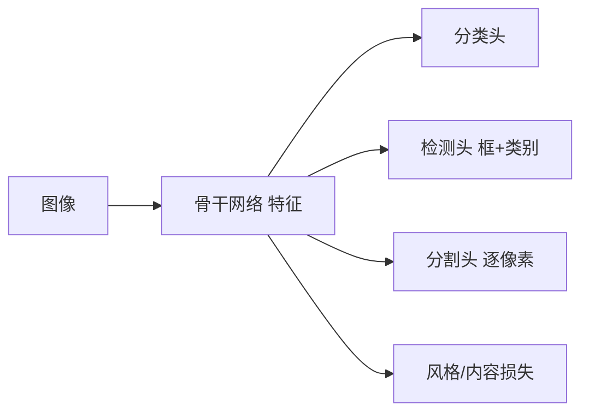

# 第 9 章：计算机视觉

- **难度**：★★★ | **预估学时**：6 小时 | **前置**：第 5、7 章

## 学习目标
学完本章，你能：说清图像增广为什么等价于一种正则；写出微调的标准流程；解释 IoU、锚框、NMS 在目标检测里各解决什么问题；区分语义分割与实例分割；说明风格迁移的损失由哪两部分构成。

## 一句话核心
计算机视觉的进展一半来自模型结构，一半来自“怎么把图像任务转化成可优化的损失”。

## 零基础讲解

### 概念 1：图像增广（难度：基础）
随机翻转、裁剪、变色、旋转，扩大训练集的分布覆盖。**它等价于一种正则**：模型不能靠“记住固定位置的固定像素”来分类，必须学更不变的特征。

**注意**：增广不能破坏标签语义。把“6”旋转 180° 就变成“9”，这类增广会引入错标。

### 概念 2：微调（难度：进阶）
标准流程：加载预训练权重 → 替换最后的分类层（输出维度改为自己的类别数）→ 冻结前面的层或全部解冻 → 用较小学习率训练。

**两类参数的学习率可以不同**：预训练部分用 1e-5，新分类头用 1e-3，这叫差别学习率，实践中很常用。

### 概念 3：目标检测三件套（难度：高难）
- **IoU**：两个框的交集面积除以并集面积，衡量框的重合度，也是评估指标。
- **锚框**：在特征图每个位置预设多个不同尺度/比例的参考框，模型预测“相对锚框的偏移量 + 是否包含物体”。这样把“回归任意框”变成“回归小幅偏移”，学起来稳定得多。
- **NMS**：同一物体会有多个高分框，按分数排序，保留最高的，删掉与它 IoU 超过阈值的其余框，重复。没有 NMS 会输出一堆重叠框。

**实例**：两个框 A=[0,0,100,100]、B=[50,50,150,150]。交集 50×50=2500，并集 10000+10000-2500=17500，IoU=0.143，低于常见阈值 0.5，判为不同物体。

### 概念 4：分割与风格迁移（难度：高难）
**语义分割**：每个像素分类，同类不区分个体；**实例分割**：还要区分不同个体。FCN 用转置卷积把特征图放大回原尺寸，逐像素分类。

**风格迁移**：内容损失比较生成图与内容图在深层特征上的差异，风格损失比较 Gram 矩阵（特征通道间的相关性）。两者加权求和作为总损失，直接对生成图像做梯度下降。

## 图示

看图说明：同一个骨干可以接不同头，这是迁移学习在视觉里通用的原因——底层特征是共享的。

## 常见误解
- 别以为增广越多越好——实际上破坏语义的增广会直接制造错误标签。
- 别以为 NMS 可以省掉——实际上没有它检测输出无法使用。
- 别以为微调必须冻结所有层——实际上数据量稍大时全部微调效果更好，只是学习率要小。

## 自测题（答案）
1. IoU 的定义是？（答案：B；解析：交集面积除以并集面积。）
   - A. 交集除以两者面积之和　B. 交集除以并集　C. 并集除以交集　D. 中心点距离
2. NMS 的作用是？（答案：C；解析：抑制同一物体的重复检测框。）
   - A. 生成锚框　B. 计算损失　C. 去除重叠框　D. 放大特征图
3. 风格迁移的风格损失基于？（答案：A；解析：特征图的 Gram 矩阵，刻画通道间相关性。）
   - A. Gram 矩阵　B. 像素差　C. 分类交叉熵　D. IoU

## 复习锚点
- 增广 = 正则，但不能破坏标签语义。
- 微调：换头、冻结或全解冻、小学习率。
- 检测三件套：IoU 度量、锚框回归偏移、NMS 去重。
- 风格迁移 = 内容损失 + 风格损失，直接优化图像。
