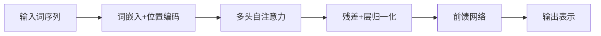

# 第 10 章：自然语言处理

- **难度**：★★★ | **预估学时**：6 小时 | **前置**：第 6、9 章

## 学习目标
学完本章，你能：说清 word2vec 的两种训练方式与负采样为什么能加速；解释 GloVe 与 word2vec 的目标差异；画出 seq2seq + 注意力的结构；写出 Transformer 自注意力的计算式并说明为什么除以 √d_k。

## 一句话核心
NLP 的核心难题是“把变长序列变成定长表示”，词嵌入解决“词怎么表示”，注意力解决“信息怎么对齐”。

## 零基础讲解

### 概念 1：词嵌入（难度：进阶）
**one-hot 的问题**：词表一万，每个词是一万维稀疏向量，任意两词内积为 0，无法表达相似性。

**word2vec 两种方式**：
- **跳元模型（skip-gram）**：用中心词预测上下文。`P(w_o|w_c) = exp(u_oᵀv_c)/Σ exp(u_kᵀv_c)`。
- **连续词袋（CBOW）**：用上下文预测中心词。

**负采样**：分母要对整个词表求和，代价太大。改成“正样本 + 若干随机负样本”的二分类任务，把 O(V) 降到 O(K)。

### 概念 2：GloVe（难度：进阶）
word2vec 只看局部窗口，GloVe 直接拟合全局共现矩阵：`w_iᵀw̃_j + b_i + b̃_j ≈ log X_ij`，用加权最小二乘。**它把“局部上下文预测”换成“全局统计拟合”，两者最终得到的嵌入性质相近。**

### 概念 3：seq2seq 与注意力（难度：高难）
编码器把输入序列压成一个定长向量，解码器从它生成输出。**问题**：无论句子多长都压成一个向量，长句信息丢失严重。

**注意力**：解码每一步都回头看编码器的所有隐状态，按相关性加权求和。`α_{t,s} = softmax(score(h_t, h̄_s))`，`c_t = Σ α_{t,s} h̄_s`。这样信息不再被压缩，而是按需取用。

### 概念 4：Transformer（难度：高难）
自注意力：`Attention(Q,K,V) = softmax(QKᵀ/√d_k)V`。

**为什么除 √d_k**：Q 与 K 的每个分量独立、方差为 1，点积的方差是 d_k。d_k 大时点积数值很大，softmax 会进入饱和区，梯度趋近 0。除以 √d_k 把方差拉回 1，这是为了梯度稳定，不是为了数值范围好看。

**多头**：把 Q、K、V 投影到 h 组低维子空间分别做注意力再拼接。不同头能关注不同的关系（语法、指代、位置）。

**位置编码**：自注意力本身对顺序无感（打乱输入结果不变），所以必须额外加位置信息。

## 图示

看图说明：注意残差与层归一化的位置。没有残差，深层 Transformer 训不动。

## 常见误解
- 别以为词嵌入维度越高越好——实际上维度要与语料规模匹配，太大反而学不好。
- 别以为注意力机制有可解释性就等于因果——实际上注意力权重高不代表该词决定了输出。
- 别以为 Transformer 不需要位置编码——实际上去掉之后它退化成词袋模型。

## 自测题（答案）
1. 负采样把复杂度从 O(V) 降到？（答案：B；解析：只算少量负样本，复杂度与负样本数 K 相关。）
   - A. O(1)　B. O(K)　C. O(log V)　D. 不变
2. 自注意力除以 √d_k 的目的是？（答案：C；解析：把点积方差拉回 1，避免 softmax 饱和导致梯度消失。）
   - A. 减少参数　B. 加快收敛　C. 防止点积过大使 softmax 饱和　D. 归一化输入
3. Transformer 为什么需要位置编码？（答案：A；解析：自注意力对顺序不敏感。）
   - A. 自注意力无序　B. 防止过拟合　C. 减少计算　D. 词嵌入维度不够

## 复习锚点
- one-hot 无法表达相似，词嵌入可以。
- 负采样把词表求和变成二分类。
- 注意力解决长序列压缩问题。
- 除以 √d_k 是为了 softmax 不饱和；位置编码补顺序信息。
