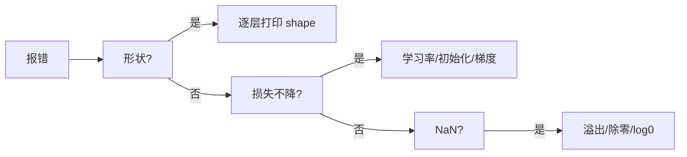

# 第 11 章：附录：数学与工具

- **难度**：★☆☆ | **预估学时**：2 小时 | **前置**：全书

## 学习目标
学完本章，你能：查清书里用到的线代、微积分、概率符号；用书里的工具脚本跑通一次训练；知道遇到环境问题该看哪一节。

## 一句话核心
附录不是“选读”，它是全书的符号表与排错手册。

## 零基础讲解

### 概念 1：数学符号回顾（难度：基础）
- **求和与求平均**：`Σᵢ xᵢ` 是求和，除以 n 是平均。期望 `E[X]` 就是按概率加权的平均。
- **矩阵运算**：`Aᵀ` 是转置（行变列），`A ⊙ B` 是逐元素乘，`A @ B` 是矩阵乘。
- **范数**：`||x||₂` 是欧氏长度，`||x||₁` 是绝对值之和。L1 产生稀疏、L2 抑制大幅值，前面第 11 章讲过。
- **偏导与链式法则**：`∂f/∂x` 表示只对 x 求导、其余视为常数；复合函数用链式法则连乘。

### 概念 2：常用工具（难度：基础）
- **环境**：conda 或 venv 隔离依赖，GPU 版本要装对应 CUDA 的包。
- **数据**：`DataLoader` 负责批处理与打乱，`num_workers` 影响数据加载速度。
- **可视化**：训练曲线（损失、准确率随 epoch 变化）是最基本的诊断工具。

### 概念 3：排错清单（难度：进阶）
1. 形状报错 → 打印每一步的 `shape`，对照公式核。
2. 损失不降 → 查学习率、初始化、激活、梯度范数。
3. 损失变 NaN → 查 exp 溢出、log(0)、除零、学习率过大。
4. 显存 OOM → 减 batch、梯度累积、混合精度、重计算。
5. 结果不可复现 → 固定随机种子、关闭非确定性算子。

## 图示

看图说明：排错要从最确定的问题开始，形状错误永远是第一顺位，因为它必然导致后续全错。

## 常见误解
- 别以为数学附录可以跳过——实际上符号不懂，后面每一章的公式都读不下去。
- 别以为结果不可复现是玄学——实际上多半是随机种子或非确定性算子的问题。

## 自测题（答案）
1. `A ⊙ B` 与 `A @ B` 的区别？（答案：B；解析：前者逐元素乘，后者矩阵乘。）
   - A. 完全相同　B. 逐元素乘 vs 矩阵乘　C. 都是转置　D. 前者是求逆

## 复习锚点
- 符号表：Σ、E、ᵀ、⊙、@、‖·‖。
- 排错顺序：形状 → 损失 → NaN → 显存 → 复现性。
