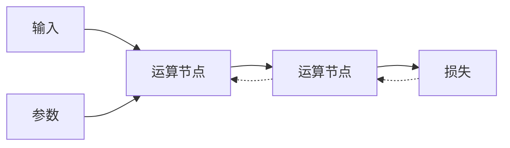

# 自动求导与计算图

- **难度**：进阶 | **涉及章节**：第 2、3 章

## 一句话定义
框架在前向时记录每一步运算，反向时按记录逆序执行链式法则，自动算出所有参数的梯度。

## 为什么重要
它把“推导反向公式”这件容易出错的事变成机械过程。模型一改，梯度自动跟着变。

## 图示

## 详解
只有声明需要梯度的变量参与的运算才被记录。反向执行完后梯度存在 `.grad` 里，优化器读它更新参数。

一个实操要点：梯度会累加而不是覆盖，所以每轮更新前必须清零，否则会越滚越大——这是新手最常见的错误之一。

## 常见误解
**别以为梯度会每轮自动清零**——必须手动清，否则等于把历史梯度全加在一起。

## 在书中出现的脉络
| 章节 | 语境 | 关键结论 |
|---|---|---|
| 第 2 章 | autograd 入门 | 基本用法 |
| 第 3 章 | 训练循环 | 每轮清零梯度 |

## 相关概念
- 前置：链式法则
- 后续：优化器、梯度裁剪
