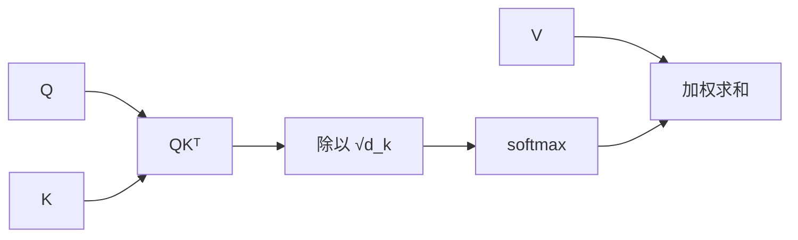

# 缩放点积注意力

- **难度**：高难 | **涉及章节**：第 10 章

## 一句话定义
用查询 Q 与键 K 的点积衡量相关性，经 softmax 得到权重，再对值 V 加权求和。

## 为什么重要
它是 Transformer 的核心，也是今天几乎所有大模型的基石。理解它等于理解了“序列内部如何互相参考”。

## 图示

## 详解
点积越大说明查询与键越匹配。除以 √d_k 是因为每个分量方差为 1 时点积方差为 d_k，维数高时点积过大会让 softmax 进入饱和区、梯度消失。

多头机制把 Q、K、V 投影到多个低维子空间，让不同头关注不同类型的关系，最后拼接。

## 常见误解
**别以为注意力权重能直接当解释**——高权重不等于因果贡献，它只是相关性的一种度量。

## 在书中出现的脉络
| 章节 | 语境 | 关键结论 |
|---|---|---|
| 第 10 章 | seq2seq 注意力 | 解决长序列压缩 |
| 第 10 章 | Transformer | 自注意力 + 多头 + 位置编码 |

## 相关概念
- 前置：softmax、矩阵乘法
- 后续：多头注意力、位置编码
