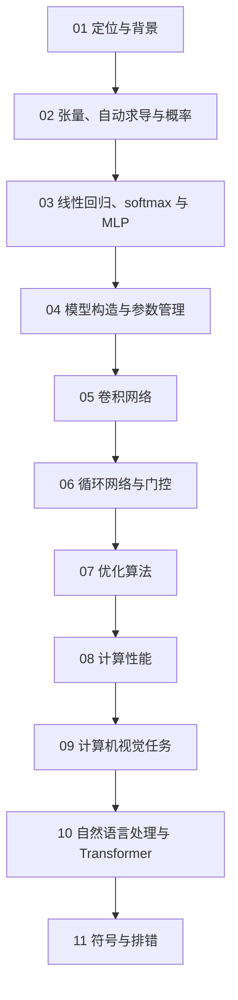

# 学习路径：动手学深度学习

## 路径总览

## 逐步展开

### 步骤 01：定位与背景
**阅读**：ch01
**检查点**：说清深度学习兴起的三个条件
**目标**：建立全局位置感

### 步骤 02：张量、自动求导与概率
**阅读**：ch02
**检查点**：写完一段 autograd 代码并手算核对梯度
**目标**：掌握全书的最小工具集

### 步骤 03：线性回归、softmax 与 MLP
**阅读**：ch03
**检查点**：独立写出 softmax 回归的完整训练循环
**目标**：跑通第一个可训练模型

### 步骤 04：模型构造与参数管理
**阅读**：ch04
**检查点**：自定义一个有参数的层并确认它被优化器更新
**目标**：掌握工程化写法

### 步骤 05：卷积网络
**阅读**：ch05
**检查点**：手算三种配置的卷积输出尺寸与参数量
**目标**：掌握视觉模型的基本构件

### 步骤 06：循环网络与门控
**阅读**：ch06
**检查点**：画出 LSTM 的门控数据流并解释加法路径
**目标**：掌握序列建模

### 步骤 07：优化算法
**阅读**：ch07
**检查点**：手推 Adam 一步更新
**目标**：理解优化器在解决什么问题

### 步骤 08：计算性能
**阅读**：ch08
**检查点**：针对三种瓶颈各给一条对策
**目标**：能定位训练速度问题

### 步骤 09：计算机视觉任务
**阅读**：ch09
**检查点**：写出微调流程并算一个 IoU
**目标**：掌握检测与分割的转化思路

### 步骤 10：自然语言处理与 Transformer
**阅读**：ch10
**检查点**：推导 √d_k 缩放的方差理由
**目标**：掌握注意力机制

### 步骤 11：符号与排错
**阅读**：ch11
**检查点**：按排错清单定位一个真实报错
**目标**：建立可维护的调试习惯

## 学完全程后

