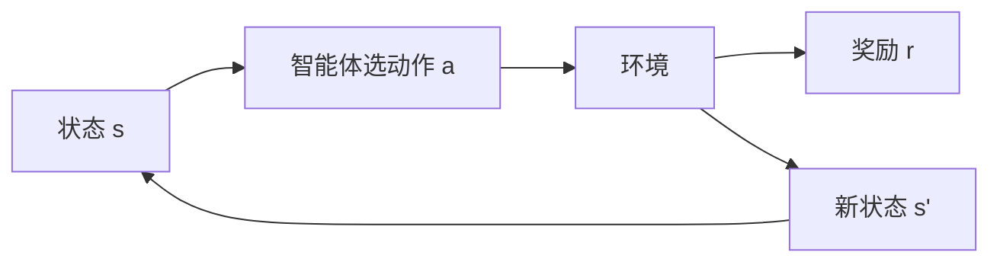

# 第 1 章：导论

- **难度**：★☆☆ | **预估学时**：2 小时 | **前置**：无

## 学习目标
学完本章，你能：说出强化学习区别于监督学习的三个特征；列出强化学习智能体的四个要素；用井字棋例子说明“价值”与“试探”的关系；判断一个现实问题是否适合用强化学习。

## 一句话核心
强化学习研究“在只有延迟奖励、且自己的行为会改变未来数据分布的情况下，如何学会做决策”。

## 零基础讲解

### 概念 1：三个关键特征（难度：基础）
1. **没有即时标签**：只有奖励，而且可能延迟到几十步之后。
2. **数据由策略产生**：你看到的数据取决于你之前怎么行动，分布会随策略变化。
3. **试错与探索**：必须主动尝试没做过的动作，才能知道它好不好。

**与监督学习的对比**：监督学习是“我给你每个问题的正确答案”，强化学习是“你做完一局我给你一个分数，具体哪一步错了你自己想”。

### 概念 2：四个要素（难度：基础）
- **策略 π(a|s)**：在每个状态选动作的规则，是智能体的核心。
- **奖励 R**：环境给的即时信号，定义“什么算好”。
- **价值函数 v(s)**：从该状态出发的长期累积奖励期望，比即时奖励更能指导决策。
- **模型（可选）**：对环境转移的预测，有模型就能做规划。

**价值为什么必要**：奖励是眼前的，价值是长远的。只看奖励会在“小奖励的短路径”和“大奖励的长路径”之间选错。

### 概念 3：井字棋例子（难度：进阶）
用一张表存每个局面的“胜率估计”。下棋时：选一个自己估计胜率最高的走法，但有 ε 概率随机走（探索）。对局结束后，用结果反过来更新路径上每个局面的估计：`V(s) ← V(s) + α[V(s') - V(s)]`。

**这个例子包含全部要素**：价值函数（那张表）、策略（ε-贪心选点）、奖励（赢了 +1）、以及“用自己的估计更新自己”（自举）。后面十几章都是把这个粗糙的想法做严谨。

### 概念 4：什么时候不该用（难度：进阶）
如果环境是静态的、有大量标注数据、且决策之间互不影响，监督学习更划算。强化学习的优势在“序列决策 + 反馈延迟 + 需要探索”的场景。

## 图示

看图说明：注意从状态到动作再到环境，形成一个闭环。数据不是事先准备好的，是这个环转出来的。

## 常见误解
- 别以为奖励设计是小事——实际上奖励写错，智能体会学出荒诞但“最优”的行为，这叫奖励黑客。
- 别以为价值函数就是打折的奖励和——实际上在有模型偏差、函数逼近时它只是个估计，会错。
- 别以为探索越少越好——实际上不探索就永远不知道别的动作有多好。

## 自测题（答案）
1. 强化学习与监督学习最本质的差别是？（答案：C；解析：数据由策略产生且奖励延迟，没有即时正确标签。）
   - A. 用了神经网络　B. 数据更多　C. 无即时标签且数据分布随策略变化　D. 需要 GPU
2. 四个要素中，直接决定“做什么”的是？（答案：A；解析：策略 π(a|s) 是行为规则。）
   - A. 策略　B. 奖励　C. 价值函数　D. 模型
3. 井字棋例子中“自举”体现在？（答案：B；解析：用自己的价值估计 V(s') 更新 V(s)。）
   - A. 用奖励更新　B. 用自己的估计更新自己的估计　C. 用对手的策略更新　D. 用随机数更新

## 复习锚点
- 三大特征：延迟奖励、数据自产、必须探索。
- 四要素：策略、奖励、价值、模型。
- 自举 = 用自己的估计更新自己的估计。
