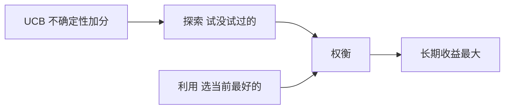

# 第 2 章：多臂赌博机

- **难度**：★★☆ | **预估学时**：3 小时 | **前置**：第 1 章、期望与方差

## 学习目标
学完本章，你能：写出 ε-贪心的增量式实现；解释乐观初始值为什么能驱动探索；写出 UCB 的选择公式并说明探索项的作用；区分赌博机与完整强化学习问题的差别。

## 一句话核心
赌博机是强化学习里“只有探索与利用、没有状态”的最简形态，所有探索策略都先在这里验证。

## 零基础讲解

### 概念 1：动作价值与增量更新（难度：基础）
第 a 个臂的价值 `q(a) = E[R|A=a]`。用采样平均估计：`Q_{n+1} = Q_n + (1/n)(R_n - Q_n)`。

**为什么写成增量式**：直接存总和再除以次数需要 O(n) 内存；增量式每步只算一次减法、一次除法，内存恒定。把 1/n 换成常数 α 就得到“指数近因加权平均”，适合非平稳环境。

**实例**：前三次收益 1、2、3。Q 依次为 1、1.5、2；增量式第四步若收益 4，Q = 2 + (1/4)(4-2) = 2.5，与 (1+2+3+4)/4=2.5 一致。

### 概念 2：ε-贪心（难度：基础）
以 1-ε 选当前 Q 最大的臂，以 ε 均匀随机选。**它的探索是“盲探”**——不管某个臂已经被试过一万次，被随机选中的概率和没试过的一样。

**改进方向**：让探索偏向“不确定性大”的臂，这就是乐观初始值和 UCB 的思路。

### 概念 3：乐观初始值与 UCB（难度：进阶）
**乐观初始值**：把所有 Q 初始化成一个偏高的值（比如 5，而真实均值只有 1）。这样每个臂第一次被选中都会得到“失望”，Q 下降；算法于是转向别的臂，直到全部被拉回现实。它是“用初值骗出探索”，前期探索密集，且随时间自然衰减。

**UCB**：`A_t = argmax_a [Q_t(a) + c√(ln t / N_t(a))]`。第二项是“不确定性奖励”：N 小（试得少）时它大，鼓励探索；试多了自然变小。c 控制探索强度。

**实例**：t=100 时，臂 A 试了 90 次、Q=0.8；臂 B 试了 10 次、Q=0.6。取 c=2：A 的项 = 2√(ln100/90)=2×0.226=0.45，总分 1.25；B 的项 = 2√(ln100/10)=2×0.679=1.36，总分 1.96。B 胜出——尽管当前均值更低，但不确定性更大。

### 概念 4：梯度赌博机与关联搜索（难度：进阶）
**梯度赌博机**：不估价值，直接学“选各臂的概率” `H(a)`，用 `softmax` 转成概率，按 `H(a) ← H(a) + α(R - R̄)(1 - π(a))` 更新。它适合价值会漂移的非平稳环境。

**关联搜索**：赌博机加上“状态”就变成关联搜索任务——不同状态下最优臂不同。这是从赌博机通往完整强化学习的桥梁。

## 图示

看图说明：探索与利用不是对立，而是同一个目标的两条路径。UCB 把“该探索多少”量化成了一个可计算的加分项。

## 常见误解
- 别以为 ε-贪心足够好——实际上它的探索是盲目的，在臂很多时浪费大量步数。
- 别以为乐观初始值能一直用——实际上非平稳环境里初值很快失效，还得靠 α 衰减。
- 别以为赌博机就是强化学习——实际上它没有状态转移，没有“这一步影响下一步”的结构。

## 自测题（答案）
1. 增量式均值更新中，第 n 次的步长是？（答案：B；解析：Q_{n+1}=Q_n+(1/n)(R_n-Q_n)。）
   - A. α 固定　B. 1/n　C. n　D. 1
2. UCB 的探索项在什么情况下变大？（答案：A；解析：N_t(a) 小即试得少时，√(ln t/N) 变大。）
   - A. 该臂被尝试次数少　B. 该臂价值高　C. 总步数少　D. c 取负
3. 乐观初始值驱动探索的机制是？（答案：C；解析：初值偏高，每次尝试都会“失望”，迫使算法转向别的臂。）
   - A. 随机扰动　B. 衰减学习率　C. 高初值导致失望驱动转向　D. 梯度上升

## 复习锚点
- 增量式均值：Q += (1/n)(R-Q)，换 α 就变指数加权。
- ε-贪心盲探，UCB 按不确定性探索。
- 乐观初始值：用高初值骗出前期探索。
- 赌博机无状态，关联搜索才引入状态。
