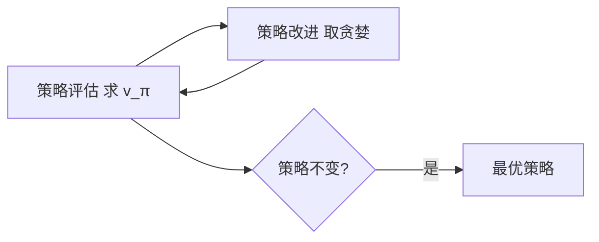

# 第 4 章：动态规划

- **难度**：★★★ | **预估学时**：4 小时 | **前置**：第 3 章

## 学习目标
学完本章，你能：写出策略评估的迭代式并说明它为什么收敛；写出策略改进定理的结论；区分策略迭代与价值迭代；解释异步 DP 与广义策略迭代的关系。

## 一句话核心
已知完整模型时，动态规划用“评估—改进”的循环把贝尔曼方程迭代求解出来。

## 零基础讲解

### 概念 1：策略评估（难度：进阶）
`V_{k+1}(s) ← Σ_a π(a|s) Σ_{s',r} p[r + γV_k(s')]`，反复迭代直到 V 不再变化。

**为什么收敛**：这个更新是一个 γ-压缩映射（γ<1），每次迭代都把误差至少压到 γ 倍，所以必然收敛到 v_π。这是压缩映射不动点定理的直接应用。

**实例**：4×4 网格世界，每步奖励 -1，γ=1，随机策略。迭代 1 次后每格 -1，2 次后 -2……最终收敛到“到终点的负步数”。这个例子说明评估在算“按当前策略走，平均要走多少步”。

### 概念 2：策略改进（难度：高难）
对每个状态，取 `argmax_a Σ_{s',r} p[r + γV(s')]`。**策略改进定理**保证：这样得到的贪婪策略 π' 一定不差于原策略 π，即 `v_{π'}(s) ≥ v_π(s)` 对所有 s 成立。

**为什么会更好**：原策略是在“已知 V 的情况下”选的，贪婪策略是在同样的 V 上取最大，所以每个状态的一步收益都不低于原来。这个论证只依赖一步，但通过贝尔曼方程的递归，它推广到长期。

### 概念 3：策略迭代与价值迭代（难度：进阶）
- **策略迭代**：评估到收敛 → 改进 → 再评估，直到策略不再变。外层循环通常很少（几次到十几次）。
- **价值迭代**：把评估只做一步就立刻改进，合并成一个更新：`V_{k+1}(s) ← max_a Σ p[r + γV_k(s')]`。

**差别**：策略迭代每次评估很贵但外层少；价值迭代每步便宜但需要更多步。二者都是广义策略迭代的特例。

### 概念 4：异步 DP（难度：进阶）
不必等全表更新完，可以按任意顺序只更新一部分状态。只要每个状态被无限次访问，收敛性仍成立。这为后面的“采样更新”（只更新实际访问到的状态）铺路。

## 图示

看图说明：评估和改进交替进行，两者的不动点就是最优策略。价值迭代只是把这个环压成一步。

## 常见误解
- 别以为 DP 只适用于小问题——实际上它的思想（用估计更新估计）是整个强化学习的骨架，只是“全表扫描”这一步在大问题上做不了。
- 别以为策略迭代一定比价值迭代好——实际上状态多时价值迭代更省。
- 别以为 DP 需要精确模型就毫无用处——实际上很多规划算法是它的近似版本。

## 自测题（答案）
1. 策略评估收敛的理论依据是？（答案：B；解析：贝尔曼更新是 γ-压缩映射。）
   - A. 凸性　B. 压缩映射不动点定理　C. 大数定律　D. 中心极限定理
2. 价值迭代与策略迭代的核心差别是？（答案：C；解析：价值迭代每次只评估一步就改进。）
   - A. 是否需要模型　B. 是否用 max　C. 评估做几步　D. 是否需要探索
3. 策略改进定理保证？（答案：A；解析：贪婪策略不差于原策略。）
   - A. 新策略不差于旧策略　B. 新策略一定最优　C. 收敛速度　D. 探索充分性

## 复习锚点
- DP = 评估 + 改进，两者都是贝尔曼方程的应用。
- 评估收敛靠 γ-压缩。
- 策略迭代外层少、价值迭代每步省。
- 异步 DP 为采样方法铺路。
