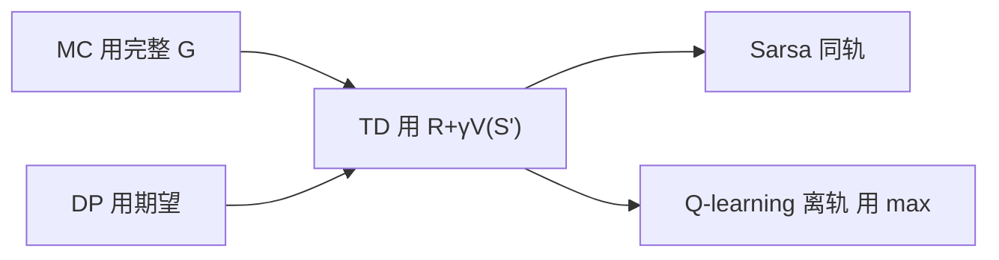

# 第 6 章：时序差分学习

- **难度**：★★★ | **预估学时**：5 小时 | **前置**：第 5 章

## 学习目标
学完本章，你能：写出 TD(0) 的更新式并解释 TD 误差；说明 TD 为什么是“MC 与 DP 的折中”；写出 Sarsa 与 Q-learning 的更新式并说出两者学的东西有什么不同；解释最大化偏差与双学习怎么解决它。

## 一句话核心
TD 用“一步奖励 + 下一状态估计”代替完整回报，既不需要模型，也不必等一幕结束。

## 零基础讲解

### 概念 1：TD(0) 与 TD 误差（难度：进阶）
`V(S_t) ← V(S_t) + α[R_{t+1} + γV(S_{t+1}) - V(S_t)]`。

方括号里是 **TD 误差** `δ_t = R_{t+1} + γV(S_{t+1}) - V(S_t)`：它衡量“新信息与旧估计的差距”。TD 误差是强化学习里最重要的一个量，不仅用于更新，还被认为是大脑学习信号的原型（第 15 章）。

**为什么它是折中**：目标 `R+γV(S')` 里有真实奖励（像 MC）也有估计值（像 DP）。所以它自举、有偏、但方差比 MC 小得多，而且能在线学习（不必等幕结束）。

### 概念 2：Sarsa（难度：高难）
`Q(S_t,A_t) ← Q(S_t,A_t) + α[R_{t+1} + γQ(S_{t+1},A_{t+1}) - Q(S_t,A_t)]`。

名字来自用到的五元组 `(S,A,R,S',A')`。它用**实际选出的下一个动作** A_{t+1} 的价值做目标，所以学的是**当前策略**（含探索）的价值。**同轨**策略。

### 概念 3：Q-learning（难度：高难）
`Q(S_t,A_t) ← Q(S_t,A_t) + α[R_{t+1} + γ max_a Q(S_{t+1},a) - Q(S_t,A_t)]`。

用下一状态的最大动作价值，不管实际选了什么。所以它直接学**最优**动作价值，与行为策略无关——**离轨**。

**行为差异的实例**：在悬崖边行走的任务里，Sarsa 因为要考虑“ε 探索可能随机走进悬崖”，会学得离崖边远一些，更安全；Q-learning 学的是最优路径，贴着崖边走，训练中掉下去的次数更多。

### 概念 4：期望 Sarsa 与最大化偏差（难度：高难）
**期望 Sarsa**：把 `Q(S',A')` 换成 `Σ_a π(a|S')Q(S',a')`。方差比 Sarsa 小（不依赖一次采样），又不像 Q-learning 那样引入 max 偏差。

**最大化偏差**：Q-learning 的 max 会让“被噪声高估的动作”被反复选中。例子：10 个动作真实价值都是 0、估计带噪声，则 max 估计的期望是正数而不是 0。

**双学习（Double Q-learning）**：维护两套 Q，用 Q1 选动作、Q2 估值（或交换），把“选择”和“评估”分开，消除偏差。

## 图示

看图说明：TD 在中间位置：左边是无偏高方差，右边是有偏低方差。Sarsa 和 Q-learning 是 TD 在控制任务上的两条分叉。

## 常见误解
- 别以为 TD 有偏就是缺点——实际上偏差换来方差大幅下降，实际收敛常常更快。
- 别以为 Q-learning 总能找到最优路径就更好用——实际上它在训练中可能反复踩坑，不适合高风险环境。
- 别以为双学习只是“平均两个估计”——实际上关键是解耦选择与评估。

## 自测题（答案）
1. TD 误差的定义是？（答案：A；解析：R_{t+1}+γV(S_{t+1})-V(S_t)。）
   - A. 目标估计减当前估计　B. 奖励减学习率　C. 价值减动作价值　D. 折扣减奖励
2. Sarsa 学的是？（答案：B；解析：用实际动作价值，学当前策略。）
   - A. 最优策略价值　B. 当前策略价值　C. 平均收益　D. 模型
3. Q-learning 的最大化偏差怎么产生？（答案：C；解析：max 会选中被噪声高估的动作。）
   - A. 学习率太大　B. 折扣太小　C. max 选择高估动作　D. 探索不足

## 复习锚点
- TD 误差 δ = R + γV(S') - V(S)。
- Sarsa 同轨学当前策略，Q-learning 离轨学最优。
- 期望 Sarsa 降方差，双学习消 max 偏差。
- 高风险场景优先考虑 SarSa 类保守行为。
