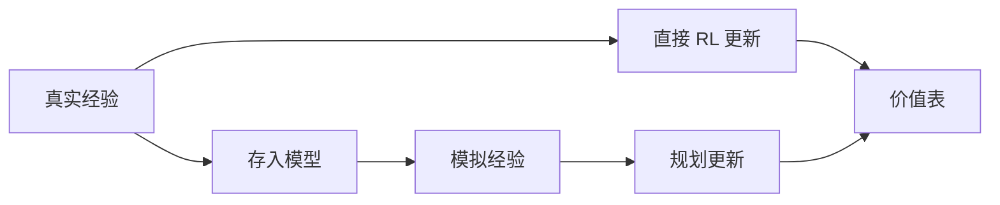

# 第 8 章：基于表格型方法的规划和学习

- **难度**：★★★ | **预估学时**：4 小时 | **前置**：第 4、6、7 章

## 学习目标
学完本章，你能：区分“学习”与“规划”在强化学习里的含义；画出 Dyna 的结构并说明它为什么比纯模型学习更省样本；解释优先级扫描的优先级怎么定；区分期望更新与采样更新。

## 一句话核心
学习从真实经验里更新价值，规划从模型产生的模拟经验里更新价值——两者用的是同一套更新规则，只是数据来源不同。

## 零基础讲解

### 概念 1：模型与规划（难度：进阶）
**模型**给出 `p(s',r|s,a)` 的估计或采样器。**规划**指用模型生成模拟经验，再对价值做更新。它不需要真实交互，所以能在两次决策之间“多想几步”。

**为什么规划能加速**：真实样本昂贵（机器人动一次要时间、要磨损），模拟样本几乎免费。

### 概念 2：Dyna（难度：高难）
结构：真实交互一步 → 直接 RL 更新（如 Q-learning）→ 把这一步存进模型 → 循环 n 次：从模型里随机抽一个存过的状态动作，生成模拟转移，做同样的更新。

**关键点**：规划和学习的更新是同一个更新，只是数据来自不同地方。Dyna-Q 在格子迷宫上比纯 Q-learning 快数倍，因为它每真实一步额外做了 n 次“想象”。

### 概念 3：优先级扫描（难度：高难）
不是随机抽状态，而是优先更新“TD 误差大”的状态。用优先队列存 `|δ|`，每次弹出最大的，更新后把它前驱状态的优先级重算并插回队列。

**为什么有效**：TD 误差大说明该状态的估计刚被显著修正，它的前驱也可能需要修正。误差会沿着依赖链向后传播，优先处理能加速收敛。

### 概念 4：期望更新与采样更新（难度：高难）
- **期望更新**：对一个状态动作，对所有可能的下一状态按概率加权求和。精度高，但要对每个分支都算。
- **采样更新**：只采一个分支。方差大但计算便宜。

**在 Dyna 里的意义**：如果分支因子很大（比如 1000 种可能转移），期望更新一次要算 1000 项，采样更新只算 1 项。计算预算固定时，做 1000 次采样更新通常比做 1 次期望更新更能降低误差。

## 图示

看图说明：两条路在最后一个节点汇合。这说明“学习”与“规划”在算法层面没有本质差异。

## 常见误解
- 别以为规划必须用精确模型——实际上采样模型（能生成一个可能的下一状态）就够用。
- 别以为模型一定准——实际上模型误差会被规划放大，这叫模型偏差。
- 别以为优先级扫描一定比 Dyna 好——实际上维护优先队列有开销，状态少时优势不明显。

## 自测题（答案）
1. 学习中“规划”的数据来源是？（答案：B；解析：模型生成的模拟经验。）
   - A. 真实交互　B. 模型模拟　C. 人工标注　D. 随机噪声
2. Dyna 相对纯 Q-learning 的优势在于？（答案：C；解析：每步真实经验后额外做 n 次模拟更新，样本效率高。）
   - A. 不需要模型　B. 不需要探索　C. 样本效率更高　D. 一定收敛更快
3. 分支因子很大时更划算的是？（答案：A；解析：期望更新要算全部分支，采样更新只算一个。）
   - A. 采样更新　B. 期望更新　C. 两者等价　D. 都不划算

## 复习锚点
- 学习用真实经验，规划用模拟经验，更新规则相同。
- Dyna = 直接 RL + 模型 + n 次模拟更新。
- 优先级扫描按 TD 误差排队。
- 分支多时采样更新更省。
