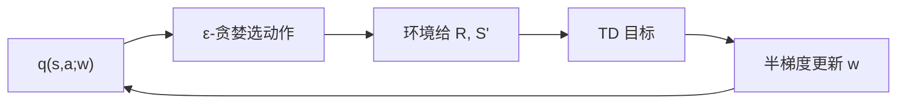

# 第 10 章：基于函数逼近的同轨策略控制

- **难度**：★★★ | **预估学时**：4 小时 | **前置**：第 9 章

## 学习目标
学完本章，你能：写出半梯度 Sarsa 的更新式；解释 episodic 与 continuing 任务在控制目标上的差别；说出平均收益形式下差分价值与差分动作价值的定义；解释为什么同轨控制也会发散。

## 一句话核心
控制比预测多了一层 max 或采样，函数逼近下这层额外结构会让稳定性问题更严重。

## 零基础讲解

### 概念 1：半梯度 Sarsa（难度：进阶）
`w ← w + α[R + γq(S',A';w) - q(S,A;w)] ∇_w q(S,A;w)`，配合 ε-贪婪从 q 选动作。

**为什么用 q 而不是 v**：没有模型时，从 v 无法推出动作的好坏，必须直接估动作价值。所以控制任务里函数逼近的对象通常是 q(s,a;w)，输入是状态动作对。

### 概念 2：分幕式与持续式（难度：进阶）
分幕式任务有终止状态，回报有限；持续式任务没有终点，回报无穷，必须用**平均收益**形式：`r(π) = lim E[R_t]`，价值定义为“相对平均收益的偏差” `v(s) = E[Σ(R - r(π))]`。

**差值形式的意义**：它把“无穷和”变成“相对基准的有限偏差”，这样才能定义收敛目标。

### 概念 3：发散的条件（难度：高难）
同轨控制也可能发散，经典反例是 Baird 反例：状态特征线性相关、更新分布不均匀时，半梯度 Sarsa 的权重会发散。

**为什么会发散**：函数逼近使不同状态的更新相互干扰；自举使目标依赖于正在被更新的参数；离轨或分布不均让某些状态被过度更新。三者叠加形成正反馈。

### 概念 4：收敛的可行方案（难度：高难）
- 用真正的梯度方法（如 GQ、GTD），它们对目标项也求导，有收敛保证但计算更贵。
- 用“目标网络 + 经验回放”（DQN 的做法），打断自举的正反馈。
- 缩小步长、正则化、特征归一化，缓解但不根治。

## 图示

看图说明：环绕一圈，参数既定义策略又定义目标。这个闭环是发散风险的来源。

## 常见误解
- 别以为同轨就一定安全——实际上只要用函数逼近和自举，同轨也会发散。
- 别以为平均收益只是“把奖励减个常数”——实际上它改变了价值的定义与更新目标。
- 别以为目标网络只是工程技巧——实际上它切断了自举的正反馈，有稳定化作用。

## 自测题（答案）
1. 控制任务里函数逼近的对象通常是？（答案：B；解析：无模型时只能用 q(s,a) 选动作。）
   - A. v(s)　B. q(s,a)　C. 模型 p　D. 奖励函数
2. 平均收益形式的价值定义为？（答案：C；解析：相对平均收益的累积偏差期望。）
   - A. 总奖励　B. 折扣总奖励　C. 相对平均收益的偏差累积　D. 最大奖励
3. 目标网络稳定训练的原理是？（答案：A；解析：用旧参数算目标，打断自举正反馈。）
   - A. 用滞后参数算目标　B. 加快学习率　C. 增加探索　D. 减少状态

## 复习锚点
- 控制用 q 不用 v；更新是半梯度。
- 持续式任务用平均收益与差分价值。
- 同轨 + 逼近 + 自举仍可能发散（Baird 反例）。
- 稳定手段：真梯度、目标网络、小步长。
