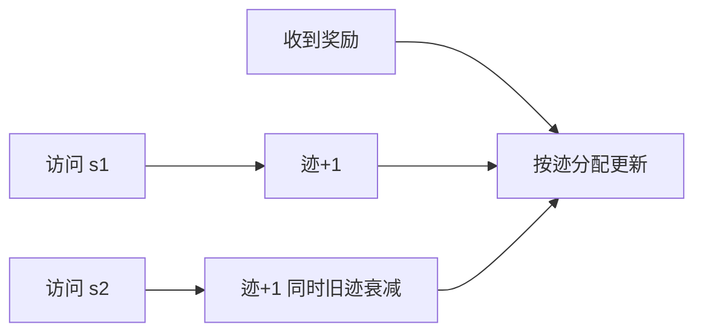

# 第 12 章：资格迹

- **难度**：★★★ | **预估学时**：5 小时 | **前置**：第 7、9、11 章

## 学习目标
学完本章，你能：写出 λ 回报的定义并说明它与 n 步回报的关系；解释资格迹在做什么（把“哪一步该为结果负责”记录下来）；区分累积迹与替换迹；说明 TD(λ) 为什么是 MC 与 TD 的统一。

## 一句话核心
资格迹给每个“最近被访问过的状态”记一个随时间衰减的信用分，让一次结果能按信用分回溯地更新很多步之前的状态。

## 零基础讲解

### 概念 1：λ 回报（难度：高难）
`G_t^λ = (1-λ) Σ_{n=1}^∞ λ^{n-1} G_{t:t+n}`，是所有权 n 步回报的几何加权平均。λ=0 时只剩 G_{t:t+1}（TD(0)）；λ=1 时退化为完整回报（MC）。

**为什么用几何权重**：越远的 n 步回报权重越小，符合“越远越不确定”的直觉，且权重和为 1（(1-λ)Σλ^{n-1}=1）。

### 概念 2：前向与后向视角（难度：高难）
- **前向视角**：直接算 λ 回报再更新，需要看完整未来，不能在线。
- **后向视角**：资格迹 `z_t = γλ z_{t-1} + ∇v(S_t)`，每次得到新奖励就按 z 更新所有权重。两者在数学上等价（对线性情形严格相等）。

**为什么后向能在线**：因为迹累积了“最近哪些状态参与了”，所以来一个新奖励就能立刻按迹分配信用。

### 概念 3：累积迹与替换迹（难度：高难）
- **累积迹**：每次访问就加 1（或加梯度），多次访问会累加很高。
- **替换迹**：每次访问把该维直接置为 1（或梯度值），不累加。替换迹更稳，因为它避免了同一状态被短时间反复访问导致的过度更新。

### 概念 4：Sarsa(λ) 与荷兰迹（难度：高难）
Sarsa(λ) 对 q 用迹更新，收敛性比单步 Sarsa 好，且能更快传播信用。**荷兰迹**是一种特殊构造，使“迹的加权和等于 λ 回报”，在函数逼近下也有更好的性质。

## 图示

看图说明：迹像一个短期记忆表，记录“最近谁参与过”。奖励来了按这张表分账。

## 常见误解
- 别以为 λ 只是一个超参数——实际上它决定了“信用回溯多远”，λ=1 就等于 MC。
- 别以为前向和后向只是实现差异——实际上它们在非线性逼近下不再严格等价。
- 别以为迹越大越好——实际上迹会让早期状态被过度更新，替换迹就是为了抑制这一点。

## 自测题（答案）
1. λ=0 的 λ 回报等价于？（答案：A；解析：只剩一步回报 G_{t:t+1}，即 TD(0)。）
   - A. TD(0)　B. MC　C. 动态规划　D. 树回溯
2. 资格迹的作用是？（答案：B；解析：记录最近参与的状态，把信用反向分配。）
   - A. 加速探索　B. 记录信用并反向分配　C. 减少状态数　D. 替代模型
3. 替换迹相对累积迹的优势是？（答案：C；解析：不累加，避免重复访问导致过度更新。）
   - A. 计算更快　B. 内存更小　C. 避免重复访问的过度更新　D. 不需要 λ

## 复习锚点
- λ 回报 = 所有 n 步回报的几何加权平均。
- 前向看未来，后向用迹在线更新，线性情形等价。
- 替换迹比累积迹稳。
- TD(λ) 在 λ=0 与 λ=1 两端连接 TD 与 MC。
