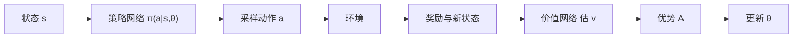

# 第 13 章：策略梯度方法

- **难度**：★★★ | **预估学时**：5 小时 | **前置**：第 9、11 章、微积分

## 学习目标
学完本章，你能：写出策略梯度定理的形式并说明为什么不需要环境模型；推出 REINFORCE 的更新式；解释基线的引入为什么不改变期望；区分 actor-critic 与纯策略梯度的差别。

## 一句话核心
不再通过价值间接决定动作，而是直接把策略参数化，用“让高回报动作概率变大”的梯度去调它。

## 零基础讲解

### 概念 1：策略参数化（难度：进阶）
`π(a|s,θ)`，离散动作用 softmax，连续动作用高斯（输出均值与方差）。

**与值函数方法的差别**：值函数方法先估价值再隐式导出策略；策略梯度直接改策略，能处理连续动作、能学随机策略（在博弈中有用）。

### 概念 2：策略梯度定理（难度：高难）
`∇J(θ) = Σ_s d_π(s) Σ_a q_π(s,a) ∇π(a|s,θ)`，可改写为 `E[Σ_t ∇log π(A_t|S_t,θ) q_π(S_t,A_t)]`。

**为什么不需要模型**：定理把“策略参数变化如何影响状态分布”那一项消掉了，只剩下对动作概率的梯度。这是它最漂亮的地方。

**`∇log π` 的含义**：它指向“让这个被选动作概率变大”的方向。乘上 q 就是“如果这个动作价值高，就往这个方向多推”。

### 概念 3：REINFORCE（难度：高难）
用一幕的实际回报 G_t 代替 q：`θ ← θ + α Σ_t G_t ∇log π(A_t|S_t,θ)`。

**问题**：G_t 方差很大，学习慢。

### 概念 4：基线（难度：高难）
把 G_t 换成 `G_t - b(s)`。**因为 `E[b(s)∇log π] = b(s)Σ_a ∇π(a|s) = b(s)∇1 = 0`**，减去任意只依赖状态的基线不改变期望，只降低方差。

常用基线是状态价值 `v(s;w)`，用另一个网络学出来。这就是 actor-critic 的雏形。

### 概念 5：Actor-Critic 与连续动作（难度：高难）
- **Actor**：策略网络，负责选动作。
- **Critic**：价值网络，负责评价，提供低方差的优势估计 `A = R + γv(S') - v(S)`。

**连续动作**：输出均值 μ(s) 与标准差 σ(s)，动作从高斯采样。更新时对 μ 和 σ 分别求导。σ 学出来代表探索强度，会随训练自适应。

## 图示

看图说明：两条网络分别负责“做”和“评”。critic 的价值越准，actor 的更新越稳。

## 常见误解
- 别以为策略梯度不需要值函数——实际上纯 REINFORCE 可以不用，但加 critic 能大幅降方差。
- 别以为基线可以随便改——实际上它必须与动作无关，否则会引入偏差。
- 别以为策略梯度只能处理离散动作——实际上它对连续动作更自然，值函数方法反而要先做 argmax 近似。

## 自测题（答案）
1. 策略梯度定理不需要模型的关键在于？（答案：B；解析：状态分布对参数的导数项被消掉。）
   - A. 用了神经网络　B. 状态分布导数项被消去　C. 用了采样　D. 用了基线
2. 减去基线的期望变化是？（答案：A；解析：E[b∇logπ]=0，期望不变方差降低。）
   - A. 期望不变、方差降低　B. 期望变大　C. 期望变小　D. 方差变大
3. Actor-Critic 中 critic 的作用是？（答案：C；解析：提供低方差的价值/优势估计。）
   - A. 选动作　B. 探索　C. 评价动作、提供优势估计　D. 存储经验

## 复习锚点
- 策略梯度：∇logπ 乘价值，直接推高好动作的概率。
- 定理消掉了状态分布导数，所以无模型可用。
- 基线不改变期望，只降方差。
- Actor 做、Critic 评，连续动作输出均值方差。
