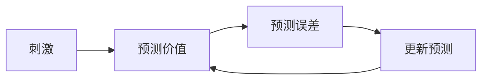

# 第 14 章：心理学

- **难度**：★★☆ | **预估学时**：2 小时 | **前置**：第 6 章

## 学习目标
学完本章，你能：说清经典条件反射与操作性条件反射的差别；解释“次级强化物”与“延迟强化”的关系；说明动物行为中的探索—利用权衡与 RL 的对应。

## 一句话核心
动物学习行为的方式，与强化学习的核心机制高度同构：都是“用预测误差驱动更新”。

## 零基础讲解

### 概念 1：两种条件反射（难度：基础）
**经典条件反射**（巴甫洛夫）：中性刺激与无条件刺激配对，形成刺激—刺激联结。**操作性条件反射**（斯金纳）：行为与后果联结，形成行为—结果联结。强化学习对应的是后者。

### 概念 2：次级强化与延迟（难度：进阶）
动物会把中性刺激变成“次级强化物”，因为它预测了未来的奖励。这正是 TD 学习在做的事：一个刺激的价值等于它对未来奖励的预测。

**延迟强化**：奖励延迟时，动物会把信用分配到“奖励到来之前的那个刺激”上，而不是所有刺激。这对应资格迹的信用分配。

### 概念 3：探索与习惯（难度：进阶）
动物在不确定环境里会保持一定探索；在稳定环境里会形成习惯（低认知成本的自动行为）。这与 ε-贪心的“长期保留小比例探索”和“模型-free 的习惯性策略”都能对应。

## 图示

看图说明：这个环与 TD 学习的更新环结构完全一致，只是“预测”由神经系统完成。

## 常见误解
- 别以为心理学这一章是“闲聊”——实际上它提供了强化学习概念的历史来源，很多术语（强化、折扣、习惯）都是从行为主义借来的。

## 自测题（答案）
1. 强化学习最接近哪种条件反射？（答案：B；解析：行为—结果联结，即操作性条件反射。）
   - A. 经典条件反射　B. 操作性条件反射　C. 观察学习　D. 顿悟

## 复习锚点
- 操作性条件反射对应 RL 的行为—结果框架。
- 次级强化物 = 对未来奖励的预测，对应价值函数。
- 延迟强化需要信用分配，对应资格迹。
