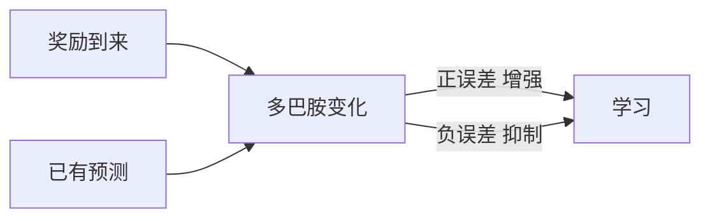

# 第 15 章：神经科学

- **难度**：★★☆ | **预估学时**：2 小时 | **前置**：第 14 章

## 学习目标
学完本章，你能：说出多巴胺信号与 TD 误差的对应关系；解释“奖励预测误差”在实验中如何被观测到；说明大脑的强化学习机制与人工 RL 的差异。

## 一句话核心
多巴胺神经元的活动模式，与 TD 误差的曲线形状高度吻合——这是“算法在生物体上找到对应物”的最强证据之一。

## 零基础讲解

### 概念 1：奖励预测误差（难度：进阶）
实验现象：动物未预期地得到奖励时，多巴胺水平骤升；预期会得到却没得到时，骤降；一直预期会得到时，没有变化。

**这正好是 δ = R + γV(S') - V(S)**：当 V(S) 已经预测到奖励，R+γV(S')-V(S) 接近 0，信号不变化；预测落空则 δ 为负。

### 概念 2：时间上的对应（难度：进阶）
若奖励总在刺激后固定时间出现，多巴胺峰值会从“奖励时刻”逐渐前移到“刺激时刻”。这正是价值从奖励向预测刺激转移的过程，与 TD 学习的收敛行为一致。

### 概念 3：差异与局限（难度：进阶）
大脑同时做模型-free 与模型-based 的决策，且两者会竞争；人工 RL 通常只实现其中一种。此外生物体的探索机制、记忆结构远比 ε-贪心复杂。

## 图示

看图说明：多巴胺不是“奖励信号”，而是“奖励与预测之差”的信号。这是本章最关键的一句。

## 常见误解
- 别以为多巴胺等于快乐——实际上它更像误差信号，快乐是另一个层面的描述。

## 自测题（答案）
1. 多巴胺信号最接近哪个量？（答案：B；解析：奖励预测误差，即 TD 误差。）
   - A. 累积奖励　B. TD 误差　C. 学习率　D. 折扣因子

## 复习锚点
- 多巴胺 ≈ TD 误差，不是奖励本身。
- 峰值随学习前移，对应价值转移到预测刺激。
- 大脑同时有模型-free 与模型-based 两套。
