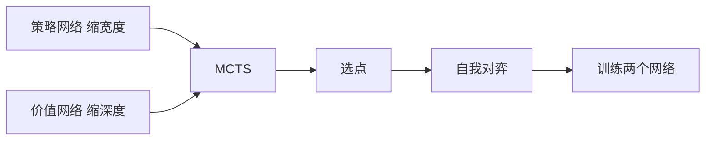

# 第 16 章：应用及案例分析

- **难度**：★★☆ | **预估学时**：3 小时 | **前置**：第 6、13 章

## 学习目标
学完本章，你能：说清 TD-Gammon 为什么用 TD(λ) 而不是纯 MC；列出 AlphaGo 中策略网络、价值网络、MCTS 各自的分工；判断一个应用场景是否适合用 RL 而非监督学习。

## 一句话核心
成功的 RL 应用往往不是“纯 RL”，而是“RL + 强先验 + 搜索”。

## 零基础讲解

### 概念 1：TD-Gammon（难度：进阶）
西洋双陆棋程序，用 TD(λ) 学一个价值网络，自我对弈产生数据。它证明了“不用人类棋谱、只靠自我对弈 + TD 学习”可以达到顶尖水平。

**为什么用 TD 而不是 MC**：棋局状态空间巨大、回报稀疏，MC 需要等一局结束才能更新；TD 每步都能更新，样本效率高得多。

### 概念 2：AlphaGo 的三个组件（难度：进阶）
- **策略网络**：给出落子概率，缩小搜索宽度。
- **价值网络**：评估局面，替代深搜到底。
- **MCTS**：把两者结合，按访问次数与价值做树搜索。

**为什么需要组合**：纯策略网络会漏掉罕见好手；纯搜索在巨大分支下算不完；价值网络给搜索提供“早停”的依据。

### 概念 3：适用性判断（难度：进阶）
适合 RL 的信号：序列决策、反馈延迟、环境可模拟、有明确的奖励定义。不适合：一次性决策、标签充足、错误代价极高且不可模拟。

## 图示

看图说明：策略网络和价值网络分别解决搜索的“宽”和“深”两个难题。

## 常见误解
- 别以为 AlphaGo 全靠 RL——实际上它大量使用了监督学习（人类棋谱预训练）与搜索。
- 别以为自我对弈一定有效——实际上没有强先验和搜索，自我对弈容易退化。

## 自测题（答案）
1. TD-Gammon 用 TD(λ) 而不用 MC 的主因是？（答案：B；解析：回报稀疏且延迟，TD 能每步更新，样本效率高。）
   - A. TD 更准　B. 样本效率更高　C. MC 不能用于棋类　D. TD 不需要探索
2. AlphaGo 中价值网络的主要作用是？（答案：C；解析：评估局面，减少搜索深度。）
   - A. 生成棋谱　B. 缩小搜索宽度　C. 评估局面减少搜索深度　D. 存储经验

## 复习锚点
- TD-Gammon 证明自我对弈 + TD(λ) 可行。
- AlphaGo = 策略网络 + 价值网络 + MCTS。
- 成功应用几乎都不是“纯 RL”。
