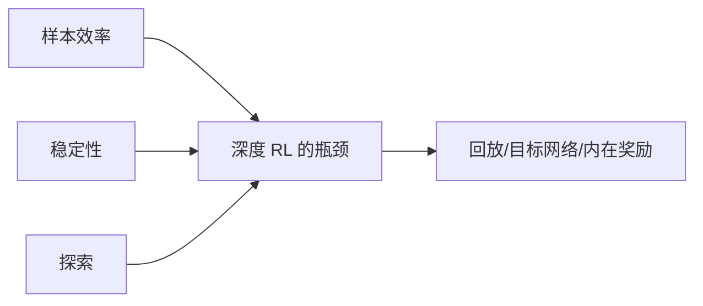

# 第 17 章：前沿技术

- **难度**：★★★ | **预估学时**：3 小时 | **前置**：全书

## 学习目标
学完本章，你能：说出深度强化学习的三个主要难点；解释通用价值函数与元学习的思路；说明为什么“探索”在稀疏奖励下是核心瓶颈。

## 一句话核心
强化学习的前沿问题集中在三处：样本效率、稳定性、以及稀疏奖励下的探索。

## 零基础讲解

### 概念 1：深度 RL 的三难（难度：进阶）
1. **样本效率低**：DQN 在 Atari 上要几百万帧，人几分钟就会。
2. **不稳定**：函数逼近 + 自举 + 离轨的三要素，靠目标网络与经验回放缓解。
3. **超参敏感**：学习率、回放大小、目标网络更新频率互相牵制。

### 概念 2：经验回放与目标网络（难度：进阶）
- **经验回放**：把转移存进缓冲区，随机采样训练，打破样本时间相关性。
- **目标网络**：用一份滞后的参数算 TD 目标，定期同步，避免“追自己”。

**这两者是 DQN 能工作的关键**，不是可选项。

### 概念 3：通用价值函数与元学习（难度：高难）
**通用价值函数**：不针对单一任务，而是学一个“对大量任务都近似最优”的价值函数，新任务只需少量交互就能适应。

**元学习**：学“怎么学”，让初始化参数或超参数本身可通过少量样本快速适应。

### 概念 4：稀疏奖励与探索（难度：高难）
奖励几乎全为 0 时，随机探索几乎不可能碰到奖励，梯度信号为零。常用手段：内在奖励（好奇心、计数）、课程学习（先易后难）、示范数据、分层 RL。

## 图示

看图说明：三个瓶颈各有对应手段，但没有一个手段能同时解决三者。

## 常见误解
- 别以为深度 RL 就是“把 Q 表换成神经网络”——实际上稳定性需要一整套配套机制。
- 别以为探索只靠 ε——实际上稀疏奖励下需要内在动机或示范。

## 自测题（答案）
1. 经验回放的主要作用是？（答案：B；解析：打破样本时间相关性，稳定训练。）
   - A. 增加探索　B. 打破样本相关性　C. 减少内存　D. 替代目标网络
2. 稀疏奖励下最直接的困难是？（答案：C；解析：几乎采不到奖励，梯度信号为零。）
   - A. 计算太慢　B. 内存不够　C. 探索效率极低　D. 无法并行

## 复习锚点
- 三难：样本效率、稳定性、探索。
- DQN 的两个支柱：经验回放 + 目标网络。
- 稀疏奖励靠内在奖励、课程、示范、分层。
