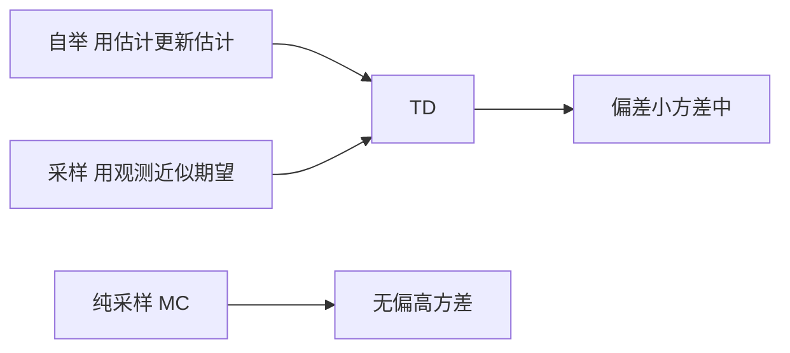

# 自举与采样

- **难度**：进阶 | **涉及章节**：第 6、9 章

## 一句话定义
自举指用当前的估计值去更新另一个估计值；采样指用一次实际观测近似期望。两者是 TD 方法的两根支柱。

## 为什么重要
所有偏差—方差权衡都来自这两件事的组合：自举降方差但引入偏差，采样无偏但方差大。理解这一点，才能判断某个算法为什么在某类问题上不稳。

## 图示

## 详解
自举的代价是“目标是移动的”：参数一改，目标也变。这就是为什么函数逼近下会出现追逐移动靶的不稳定。采样的代价是方差：单次观测与期望的差距可能很大。

n 步方法本质上是这两者的连续插值：n 小自举多，n 大采样多。

## 常见误解
**别以为自举是“作弊”**——它是用已有信息做合理外推，只要收敛条件满足，结果是对的。

## 在书中出现的脉络
| 章节 | 语境 | 关键结论 |
|---|---|---|
| 第 6 章 | TD(0) | 一步自举 |
| 第 7 章 | n 步 | 连续插值 |
| 第 9 章 | 函数逼近 | 自举 + 逼近导致不稳定 |

## 相关概念
- 前置：贝尔曼方程
- 后续：半梯度、致命三要素
