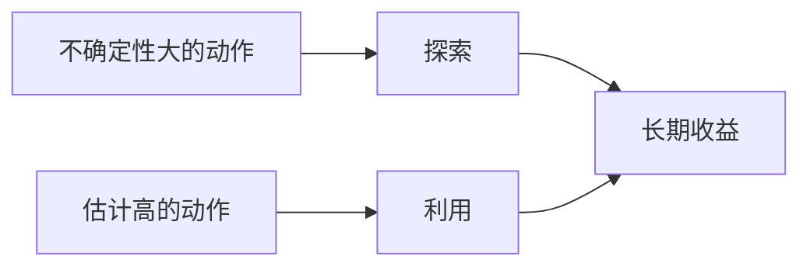

# 探索与利用

- **难度**：进阶 | **涉及章节**：第 2、13 章

## 一句话定义
利用是选当前估计最好的动作，探索是尝试信息不足的动作；两者的张力是所有序贯决策问题的核心。

## 为什么重要
不探索会永久错过更优动作；只探索则浪费收益。几乎所有 RL 算法的性能差异，一半来自探索策略的设计。

## 图示

## 详解
四种主流做法：ε-贪心（盲探）、乐观初始值（用高初值骗探索）、UCB（按不确定性加分）、汤普森采样（按后验概率抽动作）。

在深度 RL 里还有内在奖励（好奇心、计数）与熵正则，它们把探索写进目标函数而不是行为规则。

## 常见误解
**别以为探索只是“加随机”**——结构化探索（按不确定性）通常效率高一个数量级。

## 在书中出现的脉络
| 章节 | 语境 | 关键结论 |
|---|---|---|
| 第 2 章 | 赌博机 | ε-贪心、UCB、乐观初值 |
| 第 13 章 | 策略梯度 | 熵正则鼓励随机策略 |

## 相关概念
- 前置：动作价值
- 后续：内在奖励、课程学习
