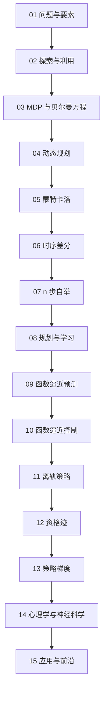

# 学习路径：强化学习（Sutton & Barto 第 2 版）

## 路径总览

## 逐步展开

### 步骤 01：问题与要素
**阅读**：ch01
**检查点**：用井字棋例子说清价值与自举
**目标**：建立强化学习的问题意识

### 步骤 02：探索与利用
**阅读**：ch02
**检查点**：手算一次 UCB 的选择
**目标**：掌握最简形态下的权衡

### 步骤 03：MDP 与贝尔曼方程
**阅读**：ch03
**检查点**：手解两状态互相转移的价值方程
**目标**：掌握形式化语言

### 步骤 04：动态规划
**阅读**：ch04
**检查点**：说出策略迭代与价值迭代的差别
**目标**：掌握有模型时的求解

### 步骤 05：蒙特卡洛
**阅读**：ch05
**检查点**：区分首次访问与每次访问，说明 IS 的风险
**目标**：掌握无模型评估

### 步骤 06：时序差分
**阅读**：ch06
**检查点**：写出 Sarsa 与 Q-learning 并说出行为差异
**目标**：掌握在线自举

### 步骤 07：n 步自举
**阅读**：ch07
**检查点**：说明 n 如何连续调节偏差与方差
**目标**：掌握 TD 与 MC 的统一视角

### 步骤 08：规划与学习
**阅读**：ch08
**检查点**：画出 Dyna 结构并解释优先级扫描
**目标**：掌握模型的使用

### 步骤 09：函数逼近预测
**阅读**：ch09
**检查点**：写出半梯度 TD 并说明“半”在哪
**目标**：掌握大规模状态的处理

### 步骤 10：函数逼近控制
**阅读**：ch10
**检查点**：解释 Baird 反例与目标网络的作用
**目标**：掌握控制中的稳定性问题

### 步骤 11：离轨策略
**阅读**：ch11
**检查点**：写出重要性采样比率并说明致命三要素
**目标**：掌握数据复用与风险

### 步骤 12：资格迹
**阅读**：ch12
**检查点**：说明 λ 回报与 TD(λ) 两端的关系
**目标**：掌握信用分配

### 步骤 13：策略梯度
**阅读**：ch13
**检查点**：推出 REINFORCE 并解释基线为何不引入偏差
**目标**：掌握直接优化策略

### 步骤 14：心理学与神经科学
**阅读**：ch14, ch15
**检查点**：说清多巴胺与 TD 误差的对应
**目标**：建立跨学科直觉

### 步骤 15：应用与前沿
**阅读**：ch16, ch17
**检查点**：判断一个场景是否适合 RL
**目标**：把方法落到真实问题

## 学完全程后

